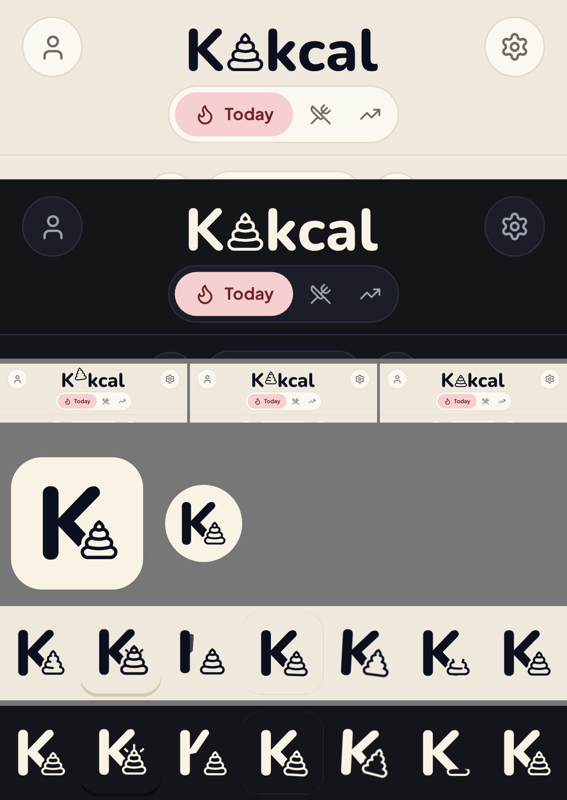

# Brand marks and launcher artwork

> **Scope:** App icon, wordmark, how launcher PNGs are generated.
>
> **Read when:** you touch `src/assets/brand/`, `Brand.tsx` or `scripts/render-brand.mjs`.
>
> **Related:** calculations-colors.md

- **App icon** (`src/assets/brand/kakcalculator-icon.svg`): generated by `scripts/generate-icon.mjs`, drawn like the Koink icon ([Koink-style icon](#koink-style-icon)): Koink's tile (`#F9F3E6`, radius 240 on a 1024 canvas), Koink's K in `#0B0F1E` and the poop where Koink's pig is. It is the browser favicon (embedded in the single-file build) and the source of the Android launcher artwork.
- **Wordmark** (`src/assets/brand/kakcalculator-wordmark.svg`): the full name (**Kakcal**: K, poop as the first "a", then `kcal`) at the top of every app page (`src/components/common/Brand.tsx`). Tapping it returns to Today. It is **generated** by `scripts/outline-wordmark.mjs` and laid out like the Koink wordmark ([Koink-style wordmark](#koink-style-wordmark)); its letters are outlines of Nunito ExtraBold (OFL licence in `public/licenses/`), so it needs no font and looks the same offline. The cream plate is removed when the wordmark is rendered, so its ink follows the theme's text colour and the page behind it: dark on light, light on dark.
- **Transparent poop:** the poop in the wordmark is an outline only (`fill: none`); the K and the letters are solid ink, as in Koink. `src/index.css` forces `fill: none !important` on `.kc-wordmark svg .kc-poop-group` and its children; an old rule coloured the poop with `--brand-flame-color` in the non-classic themes and was removed.
- **Launcher artwork** comes from `node scripts/render-brand.mjs`: legacy, round and adaptive PNGs in `android/app/src/main/res/mipmap-*` and the 512 px Play Store icon in `android/store/`. The adaptive background is `#F9F3E6` (`ic_launcher_background.xml`); the foreground is scaled (0.084 dp per icon unit) so the visible artwork stays inside the 66 dp safe circle (the script measures it and fails above 34.5 dp). The launcher label stays as the text name, because launchers cannot show the wordmark.
- **Outlined wordmark** (`kakcalculator-wordmark-outline.svg`): the same wordmark, transparent with ink `currentColor`, written by the same script. It is **no longer used by the launch screens** (they show only the background colour, see [launch-intro.md](launch-intro.md)); the script writes `index.html` / `splash_wordmark.xml` only with `--launch-screens`.
- **Notification icon**: `res/drawable/ic_stat_kak.xml` is the real logo (Koink's K + tiered poop, the icon's exact geometry; the cut-out lines are 35 % heavier than the icon's line weight, as Koink does for its pig) as a one-colour glyph on a **transparent background**, generated by `node scripts/generate-notification-icon.mjs` (`--preview out.svg` writes an SVG to look at): the K is cut away around the poop and the poop's three tier lines are cut out of it so it stays readable at 20 dp; it fills 90% of the viewport. Android paints only its alpha channel, in its own circle at the left of the notification (tinted with `iconColor`) and in the status bar. There is **no large icon**.
- **PWA icons** (`public/icons/icon-192.png`, `icon-512.png`, `maskable-512.png`, `apple-touch-icon.png`): generated from the same icon SVG by `node scripts/render-pwa-icons.mjs` (`npm i --no-save sharp` first). The maskable and Apple variants are full-bleed `#FBF3E3` squares with the artwork scaled into the safe zone. See [pwa.md](pwa.md).

## Rename: Kakcalculator -> Kakcal

The product name is **Kakcal**. The wordmark text changed from `kcalculator` to `kcal` (K + poop + `kcal` reads "Kakcal"); the canvas was narrowed from 820 to 500 px (525 px in the design-asset variants that use `textLength`, which is 201 instead of 552). `Brand.tsx` now strips the cream plate with a width-independent pattern. Regenerate the outlined wordmark with `node scripts/outline-wordmark.mjs` (its `TEXT` is now `kcal`).

Changed (user-visible): `src/i18n/translations.ts`, `tourContent.ts`, `InstallGuide.tsx` (texts and the saved APK name `Kakcal.apk`), `index.html` (title, description, iOS app title), `public/manifest.webmanifest`, `capacitor.config.json` (`appName`), Android `strings.xml`, `widget_strings.xml` (en + it), backup file name `kakcal_backup_<date>.json`, Android export name `kakcal-<date>.json`, wordmark SVGs in `src/assets/brand/` and `src/assets/kakcalculator_intro/` (logos, lockups), `android/BUILD_APK.md` headline.

Kept on purpose (not visible to users): repository name and GitHub URLs, asset file names `kakcalculator-*.svg`, `src/assets/kakcalculator_intro/`, `WIDGET_CHANNEL`, service-worker cache names, `./downloads/Kakcalculator.apk` and `Kakcalculator-Android-Studio.zip` paths (produced by `pages.yml` / `package-android.py`), package id `com.kcalsync.app`, Gradle log messages. The PNG launcher/PWA icons show only the K + poop, so they did not change. `logos-and-animations-overview.html` still shows the long wordmark in its inline previews (internal design sheet).

## Koink-style wordmark

> Round: the wordmark follows the [Koink](https://github.com/MatMon28/Koink) wordmark (`src/brand/art.js` there, [docs/brand.md](https://github.com/MatMon28/Koink/blob/main/docs/brand.md)). Preview:  (`docs/branding-render.png`: the real app header in a phone-sized WebView, light and dark, three frames of the logo-click animation, the new icon and the round launcher icon, then one mid-animation frame of each of the six launch animations plus the held end frame, in Light and in Dark).

- **Lettering.** The K is Koink's K (same stem, arm and leg geometry, same size and place). `kcal` is Nunito ExtraBold at Koink's 160.5 px, converted to outlines (kerning applied, `k` starting where its ink starts), so the wordmark is plain paths and needs no font. Before, the K was a heavy stroked K more than twice as tall as the letters and `kcal` was live `<text>`; that is why `Brand.tsx`'s `header svg text` check in `scripts/smoke.mjs` became `path.kc-text`, and why the `Nunito` `@font-face` was removed from `src/index.css` (the wordmark was its only user; the font file is still read by the script).
- **The poop stands where Koink's pig stands.** Measured from Koink's wordmark, in view-box units: the pig's outer box is x 164.2-262.0 (97.8 wide, round head = the bulk), its ears reach the top of the K, its lines are 26 x 0.885 x 0.3462 = 7.97 wide, and the next letter starts 14 to the right. The poop gets the **same left and right edge** (so the same gap to the K and to `kcal`), the **same line weight** (7.97, i.e. 3.79 in the poop's own units), its flat base on the **K's bottom edge**, and a scale of 1.871 (the 48-unit-wide tiers become 97.8 wide). Its tip stays below the K's top, as the pig's head does (only the ears and the coin reach higher). There is no coin. All of it is computed in `scripts/brand-geometry.mjs` (`WORDMARK`) from the pig's numbers, not typed in.
- **View box.** `51 40 W 150`, the same height and top as Koink's, so at the same CSS height (`h-10 sm:h-11` in the header) both wordmarks are the same size.
- **Colours are Koink's, exactly:** ink `#0B0F1E` on `#F9F3E6` (dark: `#F9F3E6` on `#070A14`), from `PALETTE` in `scripts/brand-geometry.mjs`. In the app the plate is stripped and the ink is `var(--kc-brand-ink)` (`src/index.css`: `#0B0F1E`, and `#F9F3E6` under `[data-theme="dark"]` / `"lite-dark"`), not the theme's `--text`, so the header wordmark has the same colour in every style preset.
- **Markup contract for the logo-click animation** (`Brand.tsx`, `poop-anim.css`): the poop is `<g class="kc-poop-group" ...>` (first path = outline, then three creases); the plate is `<rect class="kc-plate">`; the K is `.kc-k`, the letters `.kc-text`. The animations are in the poop's own units, so they scale with it.
- **Regenerate:** `npm i --no-save opentype.js && node scripts/outline-wordmark.mjs`. Writes `src/assets/brand/kakcalculator-wordmark.svg`, `-outline.svg`, `src/assets/kakcalculator_intro/logos/kakcalculator-wordmark{,-inverted,-theme-aware,-transparent}.svg` and `animations/wordmark.svg`.
- **Also redone for the new wordmark:** the six `*-lockup.svg` files (their last frame is this wordmark) and the overview sheet, see [Launch animations](#launch-animations-and-every-other-place-the-logo-appears). The `index.html` boot layer has no logo on purpose.

## Koink-style icon

- **Layout** (`scripts/generate-icon.mjs`, geometry in `scripts/brand-geometry.mjs`): the Koink icon with the poop in the pig's place. 1024 x 1024 canvas, tile radius 240, Koink's K (stem, arm, leg, same place), the poop with the **pig's left and right edge** (x 539.9-825.3, 285.4 wide: scale 5.404), its flat base on the pig's lowest point (y 788.7), and the same **halo** that clears the K around it (81 wide, the background colour). The poop body is filled with the tile colour so the K does not show through it. As in Koink the K's leg is cut away where the poop sits.
- **Line weight = the pig's.** The icon pig's line is 26 units; the poop's is 4.81 x 5.404 = **26.00** units. In the wordmark both are 7.97 (the pig's 26 x 0.885 x 0.3462). Checked in `generate-icon.mjs`'s output line.
- **Files:** `src/assets/brand/kakcalculator-icon.svg` (source of everything below) and `src/assets/kakcalculator_intro/logos/kakcalculator-icon{,-inverted,-theme-aware}.svg` (dark tile `#070A14` / `#F9F3E6`, and a `--kc-surface` / `--kc-contrast` variant). `Brand.tsx` (`AppIcon`) and `src/main.tsx` (favicon) import the first one.
- **Derived PNGs**, in this order: `node scripts/generate-icon.mjs && node scripts/render-brand.mjs && node scripts/render-pwa-icons.mjs` (Chromium for the first, `sharp` for the second) and `node scripts/generate-notification-icon.mjs` (`paper-jsdom`). Launcher / round / adaptive / Play PNGs and `public/icons/*` are now Koink-placed: the tile icons keep the logo where Koink has it, the adaptive foreground and the maskable icon centre it.

## Launch animations and every other place the logo appears

Generated by `node scripts/generate-intro-animations.mjs` (no dependency; geometry from `brand-geometry.mjs`):

- **The six launch animations** `src/assets/kakcalculator_intro/animations/01..06-*.svg` (what the app plays at launch, `src/components/intro/introAnimations.ts`): the same six ideas as before (sketch and plop, keypress, unfold, polarity flip, vortex, modular stack) redrawn with Koink's K (filled shapes, grown along their own axis instead of stroked) and the poop in the pig's place, on the 1024 canvas. Their last frame is the icon, with the overlay tokens: `intro.css` now sets `--kc-ink` to `#0B0F1E` (Light) and `#F9F3E6` (Lite Dark / Dark); the tile takes the page background, so only the K and the poop show in both themes. They were compared with `kakcalculator-icon.svg` frame by frame (only anti-aliasing differs).
- **The six `*-lockup.svg` files** (design assets, not used by the app): phase 1 plus the hand-off into the wordmark; the last frame matches `kakcalculator-wordmark.svg` (checked pixel by pixel). `logos-and-animations-overview.html` is regenerated by the same script and has replay buttons and a light / dark switch.
- **Header and tour** (`Wordmark`), **install guide** (`AppIcon`), **favicon** (`src/main.tsx`): read the regenerated SVGs, nothing to edit.
- **Android:** launcher, round, adaptive foreground (background `#F9F3E6`), Play Store icon, the notification glyph `ic_stat_kak.xml` and the notification accent (`iconColor` in `capacitor.config.json` and `notifications.ts`: `#0B0F1E`, was green `#2E7D4F`, so the circle round the glyph is Koink's dark tile colour). The launch screen (`splash_blank.xml`, `splash_themes.xml`) and the `splash.png` files are blank on purpose, and `drawable-v24/ic_launcher_foreground.xml` is the unused Android Studio template.
- **PWA:** `public/icons/*` (icons, maskable, apple-touch) and the new `badge-96.png`, the white-on-transparent notification glyph used as `badge` of the browser notifications (`src/utils/notifications.ts` also passes `icon-192.png` as `icon`). `offline-worker.js` is now cache `kakcalculator-shell-v4` (so installed copies refresh the icons) and `public/_headers` serves `/icons/*` with `no-cache` (the files keep their names, so they can no longer be `immutable`). The manifest colours (`#EFE9DD`) are the app's Light background, not part of the logo, and a manifest cannot change with the theme.
- **Not logo art, left alone:** the in-app poop action icons (dock, widgets: `widget_poop_icon.xml`, `widget_glyph_poop.xml`) use the same poop outline as a feature icon.

